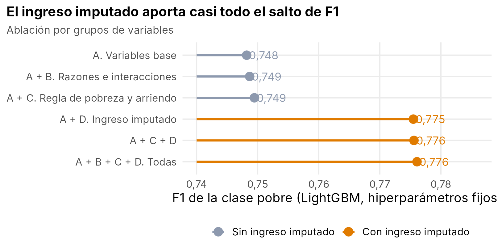
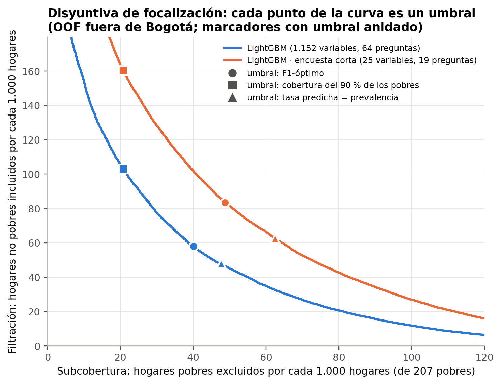
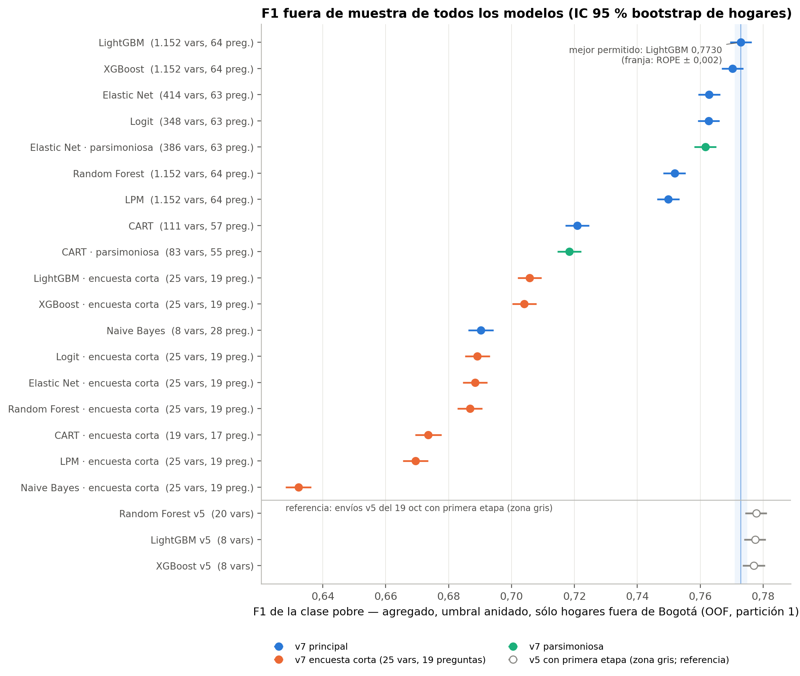

# Problem Set 2: Predicting Poverty

Big Data y Machine Learning para Economía Aplicada (MECA 4107, 2026-20) · **Equipo 02**: Jhon Sebastián Vela Salcedo,
Harold Santiago Aguilera Mulfo y Cesar Augusto Vallejo Quiroga.

> **Pregunta.** ¿Cuál es el mejor modelo para predecir la pobreza de los hogares colombianos y qué implica para la
> política pública?
>
> **Respuesta.** Un LightGBM de clasificación. El de mayor puntaje público del equipo (F1 0,78 en el tablero público;
> 0,77 en el privado) usa como variable un ingreso imputado por persona. Sin ningún modelo de ingreso, un LightGBM con
> variables observables llega a F1 0,773 en validación cruzada y 0,77 en Kaggle: el ingreso imputado ayuda mucho
> cuando las variables son pocas y poco cuando están bien construidas. Con el umbral que maximiza el F1, de cada 1.000
> hogares el modelo atiende a 167 pobres, incluye a 58 que no lo son (filtración del 26 %) y deja por fuera a 40 pobres
> (subcobertura del 19 %); una encuesta corta de 19 preguntas cuesta unos 7 puntos de F1.

## Contenido
1. [Resultados en una página](#1-resultados-en-una-página)
2. [La historia empírica](#2-la-historia-empírica)
3. [Lo que la evidencia permite afirmar y lo que no](#3-lo-que-la-evidencia-permite-afirmar-y-lo-que-no)
4. [Cómo navegar el repositorio](#4-cómo-navegar-el-repositorio)
5. [Replicación](#5-replicación)
6. [Registro de envíos a Kaggle](#6-registro-de-envíos-a-kaggle)
7. [Decisiones metodológicas](#7-decisiones-metodológicas)
8. [Detalle de los scripts](#8-detalle-de-los-scripts)
9. [Trabajo en equipo y convenciones](#9-trabajo-en-equipo-y-convenciones)
10. [Entorno](#10-entorno)

## 1. Resultados en una página

| | Modelo | Variables | F1 validación cruzada | Kaggle público | Kaggle privado |
|---|---|---|---|---|---|
| **Mejor modelo** (mayor puntaje público, §3.3) | LightGBM, 15 hojas, 954 árboles, umbral 0,39 (`09_harold_…`) | 149, con ingreso imputado por persona | 0,777 (± 0,006) | **0,78** | 0,77 |
| Mejor sin modelo de ingreso | LightGBM, 40 hojas, 1.425 árboles × 10 semillas (`29_LGBM_…_v7`) | 1.152 candidatas de 64 preguntas | 0,773 [0,770–0,776] | 0,77 | 0,77 |
| Mejor puntaje privado | LightGBM, XGBoost y Random Forest v5 (`26`–`28`) | 8–20, con ingreso esperado | 0,777–0,778 | 0,77 | **0,78** |
| Encuesta corta | LightGBM v7 (`29`, versión corta) | 25 de 19 preguntas | 0,706 | — | — |

* **Por qué gana el boosting.** La pobreza es una regla de umbral sobre el ingreso per cápita, y el error se concentra
  cerca de la línea: los árboles combinados pueden capturar las no linealidades y las interacciones de esa frontera
  (tamaño de la unidad de gasto, arriendo y ocupación). Con los mismos predictores, los algoritmos quedan a menos de 0,01 de F1;
  con muchas variables candidatas, el boosting saca ventaja (LightGBM es el único dentro del conjunto de confianza de
  modelos al 90 % entre los ocho v7).
* **Qué variables pesan.** En el mejor modelo, la razón entre el ingreso imputado y la línea de pobreza y su brecha
  (las tres variables más importantes), los subsidios y el peso del arriendo. Sin ingreso imputado, las preguntas que
  más aportan son las de la propia regla de pobreza: tamaño de la unidad de gasto (`Npersug`), parentesco, arriendo
  estimado o pagado y tenencia de la vivienda (`P5130`, `P5090`, `P5100`), y ocupación y horas trabajadas.
* **Política.** El F1 trata casi igual los dos errores (equivale a valorar un pobre excluido como 1,6 no pobres
  incluidos). Un programa que quiera cubrir al 90 % de los pobres debe aceptar más filtración: 103 no pobres por cada
  1.000 hogares en vez de 58 (umbral que implica valorar cada pobre excluido como 3,7 no pobres incluidos).
* **Kaggle.** 23 envíos con 6 de los 7 algoritmos de la lista (Boosting, Random Forest, Elastic Net, Logit, LPM y Naive
  Bayes; CART no se envió), más un probit y un XGBoost de regresión. El equipo no marcó un envío final; Kaggle evaluó el
  de mayor puntaje público y el equipo quedó 4.º de 6 en el tablero privado (0,77).

<p align="center">
  
  
</p>

## 2. La historia empírica

**Datos (Etapa 1).** Encuesta MESE/DANE: 164.960 hogares en train y 66.168 en test, con información de hogar y de
personas. Un hogar es pobre si el ingreso per cápita de su unidad de gasto (con arriendo imputado a propietarios) es
menor que la línea de pobreza de su dominio; en train lo es el 20 %. Tres hechos guían todo lo demás:
* *El ingreso sólo está en train.* Los modelos no pueden usarlo; sí pueden usar la estructura de la regla: el número de
  personas de la unidad de gasto, la línea del dominio, el arriendo y la capacidad de generar ingreso (ocupados,
  educación, formalidad). `02_harold_…`, `03_harold_…` y `datos_01_EDA_completo.py` confirman estos gradientes.
* *Desbalance moderado.* Con 20 % de pobres, clasificar a todos como no pobres acierta el 80 % y tiene F1 = 0; por eso
  se optimiza el F1 de la clase pobre y el umbral de decisión se elige fuera de muestra, en lugar de usar 0,5.
* *Bogotá no está en test.* Sus 10.567 hogares (6,4 % de train, 9,8 % de pobreza) se usan para entrenar, pero toda
  métrica y todo umbral se calculan fuera de Bogotá, que es la población del test.

**Modelos (Etapa 2).** Tres bloques de scripts con el mismo objetivo y distintas estrategias:
* *Scripts 01–17 (R + Python).* 72 variables construidas desde la teoría y un ingreso imputado por persona
  (LightGBM fuera de muestra con variables de test) agregado al hogar; diez modelos con mallas o búsquedas aleatorias,
  pruebas de robustez y una comparación en igualdad de condiciones con las mismas 40 variables (`15_harold_…`).
* *Scripts 20–25 (R).* Scripts autónomos que construyen la base, eligen variables dentro del pliegue, buscan
  hiperparámetros y eligen el umbral fuera del pliegue; seis algoritmos sin ingreso imputado.
* *Scripts 26–37 (Python, protocolo v7).* Primero con ingreso esperado como variable (v5, 26–28); luego, sin ningún
  modelo de ingreso, 1.152 variables candidatas de 64 preguntas para los siete algoritmos (29–36), cada uno con su
  método de selección, búsqueda bayesiana de hiperparámetros, validación cruzada repetida y re-evaluación en una
  partición nueva; la comparación (37) usa pruebas pareadas y un conjunto de confianza de modelos.

**El mejor modelo (Etapa 3).** El LightGBM del script 09 gana porque su variable más fuerte, la razón entre el ingreso
imputado y la línea, resume casi toda la regla de pobreza: con las variables base el F1 es 0,748 y al agregar el
ingreso imputado sube a 0,776 (figura de la izquierda). Su ventaja sobre un logit penalizado es de 0,006 y se reduce
al validar por regiones completas (`12_harold_…`). Sin ese ingreso, el mismo algoritmo alcanza 0,773 cuando las
variables observables se construyen a partir de la regla (v7): el modelo de ingreso no es indispensable.

**De la predicción a la política (Etapa 4).** El F1 equilibra precisión y cobertura, pero los dos errores no cuestan lo
mismo: un falso negativo deja a un hogar pobre sin el programa (subcobertura) y un falso positivo gasta en un hogar
que no lo necesita (filtración). Para el LightGBM v7, por cada 1.000 hogares (207 pobres):

| Regla de decisión | Pobres atendidos | No pobres incluidos (filtración) | Pobres excluidos (subcobertura) | Cupos | Costo implícito de excluir a un pobre |
|---|---|---|---|---|---|
| Umbral que maximiza el F1 | 167 | 58 (26 %) | 40 (19 %) | 225 | 1,6 no pobres incluidos |
| Cubrir al 90 % de los pobres | 187 | 103 (36 %) | 21 (10 %) | 290 | 3,7 |
| Tantos cupos como pobres | 160 | 48 (23 %) | 48 (23 %) | 207 | 1,2 |

Un gobierno que valore más no excluir a los pobres que ahorrar cupos debería usar un umbral más bajo que el que premia
el F1. En cuanto al despliegue, el modelo completo usa preguntas ya presentes en la encuesta, pero una versión corta de
19 preguntas, más barata de levantar y verificar, baja el F1 de 0,773 a 0,706 y aumenta los dos errores (filtración
del 34 % y subcobertura del 24 %); la del script 16 con sólo vivienda y hogar (S1) baja a 0,585. La encuesta corta sirve
para un primer filtro, no para reemplazar la focalización completa.

<details>
<summary>Comparación de los diez modelos de los scripts 04–12 con el mismo protocolo (<code>13_harold_analisis_comparacion_modelos.R</code>)</summary>

Validación cruzada de 5 pliegues compartidos, hogares fuera de Bogotá y umbral que maximiza el F1; entre paréntesis, la
desviación estándar del F1 entre pliegues.

| Modelo | F1 | Precisión | Cobertura | Filtración | Subcobertura | AUC | Enviado |
|---|---|---|---|---|---|---|---|
| LightGBM | 0,777 (±0,006) | 0,746 | 0,811 | 0,254 | 0,189 | 0,958 | sí |
| XGBoost (regresión + umbral) | 0,775 (±0,006) | 0,749 | 0,803 | 0,251 | 0,197 | 0,951 | sí |
| Random Forest | 0,774 (±0,006) | 0,748 | 0,801 | 0,252 | 0,199 | 0,956 | sí |
| Elastic Net (alpha 0,7) | 0,772 (±0,004) | 0,730 | 0,819 | 0,270 | 0,181 | 0,955 | sí |
| Logit robusto (59 vars) | 0,771 (±0,005) | 0,739 | 0,806 | 0,261 | 0,194 | 0,954 | sí |
| Logit (40 vars) | 0,771 (±0,005) | 0,738 | 0,807 | 0,262 | 0,193 | 0,954 | no |
| Probit robusto (59 vars) | 0,771 (±0,004) | 0,739 | 0,807 | 0,261 | 0,193 | 0,954 | sí |
| LPM (40 vars) | 0,770 (±0,006) | 0,728 | 0,816 | 0,272 | 0,184 | 0,951 | no |
| CART | 0,769 (±0,005) | 0,755 | 0,783 | 0,245 | 0,217 | 0,871 | no |
| Naive Bayes (deciles) | 0,758 (±0,005) | 0,694 | 0,834 | 0,306 | 0,166 | 0,948 | no |

El Elastic Net de la complementaria (`harold_elastic_net_lambda_0_001_alpha_0_45.csv`) clasifica como pobre sólo el
10 % de los hogares de test con umbral 0,5 (F1 de validación 0,445): sirve de punto de partida, no de candidato.
Gráficos: `harold_comparison_f1.png`, `harold_comparison_precision_recall.png`, `harold_comparison_errors.png`,
`harold_comparison_agreement.png`, `harold_lightgbm_fe_importance.png`, `harold_lightgbm_fe_effects.png`.
</details>

## 3. Lo que la evidencia permite afirmar y lo que no

* **Se puede afirmar** que el boosting es el mejor algoritmo en este problema y que el umbral de decisión importa más
  que el algoritmo entre los modelos lineales y de árboles: con los mismos predictores, LightGBM, Random Forest, Logit,
  Elastic Net y LPM quedan entre 0,770 y 0,777.
* **No se puede afirmar** que 0,78 sea mejor que 0,77 en Kaggle: el tablero público usa el 20 % del test (unos 13.000
  hogares; error estándar del F1 ≈ 0,006) y los puntajes se muestran con dos decimales. El tablero privado reordenó a
  los mejores: los v5 (26–28) pasaron de 0,77 a 0,78 y el LightGBM del script 09 de 0,78 a 0,77.
* **Los F1 de validación cruzada no son comparables entre bloques de scripts**: cada bloque (01–17, 20–25 y 26–37)
  usó su protocolo (umbral elegido en todo el OOF o anidado por pliegue, distintos pliegues). Entre bloques, compare
  los puntajes de Kaggle.
* **Primera etapa (zona gris).** El ingreso imputado se estima con un modelo entrenado en train y entra como variable de
  un clasificador; el equipo lo considera dentro de la ruta de clasificación del enunciado (§3), pero lo documenta
  aparte. El XGBoost de regresión del script 10 (`10_harold_…`) sí predice el ingreso y aplica la línea: es la ruta de
  ingreso y no se cuenta entre los algoritmos de clasificación.
* **Limitaciones.** Por plazo, algunos modelos v7 usaron presupuestos de búsqueda menores (Elastic Net, Random Forest
  y XGBoost); CatBoost no se corrió; los datos no se versionan y hay que descargarlos de Kaggle.

<p align="center">
  
</p>

## 4. Cómo navegar el repositorio

| Quiero ver… | Dónde |
|---|---|
| Limpieza, unión de personas y hogares y análisis exploratorio | `01_code/01_harold_datos_…`, `02_harold_analisis_…`, `03_harold_analisis_…`; `01_code/python/datos_00_…`, `datos_01_…`; figuras `eda_*`, `desc_*` y `02_outputs/figures/cadena_datos/` |
| Construcción de variables e ingreso imputado | `05_harold_datos_ingenieria_variables_ingreso_imputado.R`, `06_harold_…_ablacion.R`; `python/datos_02_…`, `datos_09_…`, `datos_02b_…` (primera etapa) y `datos_02d_variables_v7.py` |
| Cada modelo enviado a Kaggle | un script por modelo, con el modelo y los hiperparámetros en el nombre: `04`–`12`, `20`–`25` y `26`–`36` (sección 8) |
| El mejor modelo y su interpretación | `09_harold_modelo_lightgbm_…`, `14_harold_analisis_importancia_…` (SHAP y efectos) |
| Comparación de algoritmos en igualdad de condiciones | `13_harold_analisis_comparacion_modelos.R`, `15_harold_analisis_mismas_variables_40vars.R`, `37_comparacion_modelos_v7.R` (`02_outputs/tables/37_comparacion_modelos_v7/resultados_modelos_v7.xlsx`) |
| Errores de política y encuesta corta | `13_harold_…`, `16_harold_analisis_encuesta_corta.R`; `02_outputs/tables/37_comparacion_modelos_v7/39_politica.csv` |
| Predicciones enviadas | `02_outputs/predictions/` (sección 6) |
| Diapositivas | `03_slides/best_equipo_02.pdf`, `03_slides/compare_equipo_02.pdf` |

```
00_data/        raw/ (CSV de Kaggle, no versionados) y processed/ (bases intermedias que regeneran los scripts)
01_code/        00_rundirectory.R (maestro) · 01–17 · 20–25 · 26–37 (protocolo v7) · functions/ · python/
02_outputs/     figures/ y tables/ (scripts 01–17 en la raíz; 26–37 en una subcarpeta por script) · predictions/
03_slides/      diapositivas en LaTeX (Beamer) y sus PDF
```

## 5. Replicación

1. Descargue los datos de la competencia de Kaggle (`uniandes-bdml-2026_20-ps2`) y copie en `00_data/raw/` los
   archivos `train_hogares.csv`, `train_personas.csv`, `test_hogares.csv`, `test_personas.csv` y
   `sample_submission.csv` (no se versionan: `train_personas.csv` pesa 242 MB; ver `00_data/README.md`).
2. Instale Python ≥ 3.10 y sus paquetes: `pip install -r requirements.txt` (opcional: `PYTHON_BIN` con la ruta del
   intérprete).
3. Desde la raíz del repositorio, en R:
```r
source("01_code/00_rundirectory.R")
```
El maestro corre en orden todos los scripts numerados. Tiempos aproximados: scripts 01–17, unas 4 horas en 2 núcleos;
20–25, cada script por separado con su búsqueda (`USAR_PARAMETROS_GANADORES = TRUE` entrena sólo la
configuración ganadora); 26–37, más de 30 horas en 12 hilos la primera vez (cada uno construye la base que necesita y
deja cachés para retomar una corrida interrumpida). Cada script también se puede correr solo, desde la raíz.

## 6. Registro de envíos a Kaggle

Puntaje público: 20 % del test (tablero durante la competencia); privado: 80 % (clasificación final). F1 de validación
cruzada según el protocolo de cada bloque de scripts (no comparable entre bloques). Las predicciones de los scripts
04–12 y 26–36 están en `02_outputs/predictions/` con el mismo nombre; las de 20–25 se guardan en `salidas/` al
correr esos scripts.

| Archivo enviado | Algoritmo | Script | F1 CV | Público | Privado |
|---|---|---|---|---|---|
| `harold_lightgbm_fe_leaves_15_rounds_954.csv` | Boosting | 09 | 0,777 | **0,78** | 0,77 |
| `harold_elastic_net_fe_alpha_0_7_lambda_0_00004.csv` | Elastic Net | 07 | 0,772 | 0,77 | 0,77 |
| `harold_random_forest_fe_mtry_14_node_150.csv` | Random Forest | 08 | 0,774 | 0,77 | 0,77 |
| `harold_logit_robust_fe_alpha_1_lambda_0_00047.csv` | Logit | 12 | 0,771 | 0,77 | 0,77 |
| `harold_probit_robust_fe_59vars.csv` | Logit (probit) | 12 | 0,771 | 0,77 | 0,77 |
| `harold_xgboost_reg_fe_depth_6_rounds_910.csv` | Regresión de ingreso + umbral | 10 | 0,775 | 0,77 | 0,77 |
| `harold_elastic_net_lambda_0_001_alpha_0_45.csv` | Elastic Net (réplica de la complementaria) | 04 | 0,445 | 0,44 | 0,45 |
| `LGBM_leaves_10_lr_0_0253_mcs_22_ff_0_442_l2_0_00326_n_8.csv` | Boosting (v5) | 26 | 0,777 | 0,77 | **0,78** |
| `XGB_depth_3_eta_0_0473_mcw_1_68_sub_0_561_col_0_876_n_8_bog0_5.csv` | Boosting (v5) | 27 | 0,777 | 0,77 | **0,78** |
| `RF_mtry_0_292_minleaf_156_ms_0_443_depth_None_cw_none_trees_360_n_20_pars_bog0_5.csv` | Random Forest (v5) | 28 | 0,778 | 0,77 | **0,78** |
| `LGBM_hojas_40_lr_0_02_mcs_15_ff_0_336_l2_0_14_n1152_lb1_s10_v7.csv` | Boosting | 29 | 0,773 | 0,77 | 0,77 |
| `XGB_prof_7_lr_0_05_mcw_86_4_sub_0_945_col_0_381_l2_0_0027_n1152_lb1_s3_v7.csv` | Boosting | 34 | 0,770 | 0,77 | 0,77 |
| `LOGIT_spl_T_n348_lb1_s1_v7.csv` | Logit | 30 | 0,763 | 0,76 | 0,76 |
| `EN_a_1_lam_0_00022_n414_lb1_s1_v7.csv` | Elastic Net | 32 | 0,763 | 0,76 | 0,76 |
| `RF_mtry_0_109_hoja_16_ms_0_67_crit_log_loss_arb_1000_n1152_lb1_s1000_v7.csv` | Random Forest | 33 | 0,752 | 0,74 | 0,75 |
| `LPM_spl_T_n1152_lb0_s1_v7.csv` | Linear Probability Model | 31 | 0,750 | 0,74 | 0,75 |
| `LGBM_fe_cat_leaves_15_lr_005_nr_924_umbral_0360.csv` | Boosting | 20 | 0,731 | 0,73 | 0,73 |
| `XGB_fe_depth_6_eta_005_nr_541_umbral_0515.csv` | Boosting | 23 | 0,729 | 0,72 | 0,73 |
| `RF_fe_pb0_Ktodas_mtry_0_3_leaf_40_ss_0_472_extratrees_spw_3_13_nt_600_umbral_0_36.csv.csv` | Random Forest | 22 | 0,720 | 0,71 | 0,72 |
| `LOGIT_ingpred_fe_Ktodas_pb1_umbral_0350.csv` | Logit | 25* | 0,712 | 0,71 | 0,71 |
| `S00_EN_lambda_1e-04_alpha_01_umbral_033.csv` | Elastic Net | 24 | 0,687 | 0,68 | 0,69 |
| `NB_fe_cat_Ktodas_pb1_bins_8_lap_0137_umbral_0949.csv` | Naive Bayes | 21 | 0,657 | 0,64 | 0,65 |
| `EN_lambda_0001_alpha_045.csv` | Elastic Net (réplica de la complementaria) | — | — | 0,44 | 0,45 |

\* El script 25 del repositorio genera la variante `base` (sin ingreso predicho); el envío es la variante `ingpred`.

<details>
<summary>Predicciones del repositorio que no se enviaron a Kaggle (versiones parsimoniosas, encuestas cortas y modelos de comparación)</summary>

| Archivo | Modelo | Script | F1 CV |
|---|---|---|---|
| `harold_no_enviado_lpm_fe_40vars.csv` | LPM con las 40 variables del Random Forest | 11 | 0,770 |
| `harold_no_enviado_logit_fe_40vars.csv` | Logit sin penalización, mismas 40 variables | 11 | 0,771 |
| `harold_no_enviado_cart_fe_cp_0_001.csv` | CART, mismas 40 variables | 11 | 0,769 |
| `harold_no_enviado_naive_bayes_fe_deciles.csv` | Naive Bayes en deciles, mismas 40 variables | 11 | 0,758 |
| `LGBM_leaves_10_lr_0_0253_mcs_22_ff_0_442_l2_0_00326_n_20_pars.csv` | LightGBM v5, parsimoniosa (20 variables) | 26 | 0,777 |
| `LGBM_leaves_10_lr_0_0253_mcs_22_ff_0_442_l2_0_00326_n_173_singen.csv` | LightGBM v5 sin primera etapa (173 variables) | 26 | 0,765 |
| `XGB_depth_3_eta_0_0473_mcw_1_68_sub_0_561_col_0_876_n_173_singen_bog0_5.csv` | XGBoost v5 sin primera etapa (173 variables) | 27 | 0,761 |
| `RF_mtry_0_292_minleaf_156_ms_0_443_depth_None_cw_none_trees_600_n_25_bog0_5.csv` | Random Forest v5, principal (25 variables) | 28 | 0,777 |
| `RF_mtry_0_292_minleaf_156_ms_0_443_depth_None_cw_none_trees_360_n_179_singen_bog0_5.csv` | Random Forest v5 sin primera etapa (179 variables) | 28 | 0,721 |
| `CART_prof_24_hoja_132_mss_35_crit_entropy_cp_0_000104_n111_lb1_s1_v7.csv` | CART v7 (111 variables, 57 preguntas) | 35 | 0,721 |
| `CART_prof_24_hoja_132_mss_35_crit_entropy_cp_0_000149_n83_lb1_s1_pars_v7.csv` | CART v7, parsimoniosa (83 variables) | 35 | 0,718 |
| `NB_nb_categorico_bins_20_disc_cuantiles_alfa_9_98_n8_lb0_s1_v7.csv` | Naive Bayes v7 (8 variables, 28 preguntas) | 36 | 0,690 |
| `EN_a_1_lam_0_000279_n386_lb1_s1_pars_v7.csv` | Elastic Net v7, parsimoniosa (386 variables) | 32 | 0,762 |
| `*_n25_*_corta_v7.csv`, `CART_…_n19_…_corta_v7.csv` | Encuesta corta (25 variables de 19 preguntas) de cada modelo v7 | 29–36 | 0,632–0,706 |

</details>

## 7. Decisiones metodológicas
1. **Mismo preprocesamiento en train y test:** las bases se apilan y se procesan con las mismas funciones. Las variables
   de ingreso, que sólo existen en train, no se usan como predictores (en 01–17 se guardan con prefijo `eda_`).
2. **Unidad de gasto (UG):** el DANE calcula la pobreza sobre la UG, que excluye empleados domésticos, pensionistas y
   trabajadores (`P6050` = 6, 7, 8). Las variables del hogar se agregan sólo sobre la UG (su tamaño coincide con
   `Npersug`) y `n_outside_ug` registra cuántas personas quedan fuera.
3. **Faltantes:** los 9 («no sabe») pasan a faltante; los faltantes numéricos se imputan con la mediana de train;
   cuando una tasa no está definida (sin adultos o sin ocupados) se crea un indicador (`bin_no_adults`, `no_earner`).
   En la GEIH casi todos los faltantes de persona son saltos del cuestionario y se tratan como indicadores.
4. **Educación:** años aproximados por nivel máximo aprobado (ninguno y preescolar = 0, primaria = 5, secundaria = 9,
   media = 11, superior = 15).
5. **Arriendo:** pagado (`P5140`) o imputado a propietarios (`P5130`); la regla de MESE para el arriendo imputado se
   reconstruye sólo con variables de test, lo que permite escribir el ingreso que necesita cada hogar para no ser pobre.
6. **Bogotá sólo está en train:** se entrena con ella (su peso es un hiperparámetro en los scripts 26–36), pero toda
   métrica, umbral y comparación se calcula fuera de Bogotá. `04_harold_…` compara además tres tratamientos.
7. **Umbral:** se elige fuera de muestra para maximizar el F1 de la clase pobre (en 26–36, anidado por pliegue) y se
   traslada al test fijo o igualando la tasa de positivos, verificando que la tasa predicha sea coherente.
8. **Ingreso imputado (primera etapa):** se estima fuera de pliegue para que ningún hogar aporte su propio ingreso; ver
   la sección 3.

## 8. Detalle de los scripts

<details>
<summary>Scripts 01–17 (R; los que entrenan modelos de Python llaman a <code>01_code/python/harold_*.py</code>)</summary>

| Script | Responsabilidad | Salidas |
|---|---|---|
| `00_rundirectory.R` | Paquetes, parámetros globales (semilla 2026, 5 pliegues, rutas) y ejecución en orden de los demás scripts | `02_outputs/session_info.txt` |
| `01_harold_datos_construir_base_hogares.R` | Lee y valida las cuatro bases, procesa personas y hogares con las mismas funciones y construye las variables de hogar; sólo usa variables que existen en test | `00_data/processed/hogares_modelo.rds` |
| `02_harold_analisis_exploratorio_desbalance.R` | Desbalance de clases, pobreza por dominio, ingreso frente a la línea, correlaciones y gradientes económicos | `eda_*.png` |
| `03_harold_analisis_caracterizar_train_test.R` | Comparabilidad train-test, faltantes, pobreza por tamaño del hogar, ciclo de vida del jefe, educación por zona, tenencia | `desc_*.png` |
| `04_harold_modelo_elastic_net_alpha_0_45_lambda_0_001.R` | Réplica del ejemplo de la complementaria (logit con Elastic Net en `caret`) con tres tratamientos de Bogotá | `harold_elastic_net_lambda_0_001_alpha_0_45.csv`, `harold_elastic_net_cv_results.tex` |
| `05_harold_datos_ingenieria_variables_ingreso_imputado.R` | 72 variables `fe_*` (regla de pobreza, hacinamiento, composición, capital humano, inserción laboral, privaciones) e ingreso imputado por persona fuera de muestra (`python/harold_datos_ingreso_imputado_persona.py`); pliegues compartidos | `00_data/processed/hogares_fe.rds`, `harold_person_income_quality.tex` |
| `06_harold_analisis_diagnostico_variables_ablacion.R` | AUC univariado, información mutua, importancia por ganancia y \|SHAP\|, ablación por grupos (A base, B razones, C regla de pobreza, D ingreso imputado) | `harold_fe_*` |
| `07_harold_modelo_elastic_net_fe_alpha_0_7_lambda_0_00004.R` | Elastic Net (`glmnet`) con log1p, winsorización y splines; malla de alpha y camino de lambda | `harold_elastic_net_fe_*` |
| `08_harold_modelo_random_forest_fe_mtry_14_node_150.R` | Random Forest (`ranger`) con las 40 variables de mayor \|SHAP\|; búsqueda de `mtry`, `min.node.size` y pesos de clase | `harold_random_forest_fe_*` |
| `09_harold_modelo_lightgbm_fe_leaves_15_rounds_954.R` | **Mejor modelo.** LightGBM de clasificación (`python/harold_modelo_lightgbm_fe_leaves_15_rounds_954.py`); búsqueda aleatoria con parada temprana y reentrenamiento con tasa baja | `harold_lightgbm_fe_*` |
| `10_harold_modelo_xgboost_reg_fe_depth_6_rounds_910.R` | XGBoost de regresión sobre log(ingreso per cápita / línea) con umbral (ruta de ingreso) | `harold_xgboost_reg_fe_*` |
| `11_harold_modelo_lpm_logit_cart_cp_0_001_naive_bayes_deciles.R` | LPM, Logit, CART y Naive Bayes con las 40 variables del Random Forest | `harold_no_enviado_*`, `harold_classical_fe_cv.*` |
| `12_harold_modelo_logit_robusto_alpha_1_lambda_0_00047_probit_59vars.R` | Logit y probit diseñados para generalizar (selección por estabilidad, regla 1-EE) y pruebas de estrés (validación por dominio, calibración, ruido del 20 % del test) | `harold_{logit,probit}_robust_*`, `harold_robust_*` |
| `13_harold_analisis_comparacion_modelos.R` | Compara los diez modelos con el mismo protocolo: F1, precisión, cobertura, filtración, subcobertura, AUC y acuerdo en test | `harold_comparison_*` |
| `14_harold_analisis_importancia_lightgbm_leaves_15_rounds_954.R` | Importancia SHAP y por ganancia y efectos del mejor modelo | `harold_lightgbm_fe_importance.*`, `harold_lightgbm_fe_effects.png` |
| `15_harold_analisis_mismas_variables_40vars.R` | Elastic Net y LightGBM con las mismas 40 variables (igualdad de condiciones) | `harold_same_predictors_cv.*` |
| `16_harold_analisis_encuesta_corta.R` | LightGBM con una encuesta corta (S1: hogar y vivienda; S2: S1 más composición y educación) | `harold_short_survey_*` |
| `17_harold_diapositivas_figuras_y_cifras.R` | Figuras `harold_slide_*`, tablas de `03_slides/tables/` y cifras de `03_slides/numbers.tex` | — |

Funciones (`01_code/functions/`): `fun_data_prep.R` (preparación de personas y hogares), `fun_plot_helpers.R` (tema y
guardado de figuras), `fun_comp19.R` (ejemplo de la complementaria), `fun_features_fe.R` (arriendo e ingreso
imputados), `fun_models_fe.R` (AUC, curva F1, evaluación OOF sin Bogotá, envío validado), `fun_metrics.R` (F1,
filtración, subcobertura, umbral, pliegues) y `fun_python_modelos.R` (llama a los scripts de Python 26–37).
</details>

<details>
<summary>Scripts 20–25 (R autónomos)</summary>

Cada script lee `00_data/raw/`, construye la base de hogares, elige variables dentro del pliegue, busca
hiperparámetros, elige el umbral fuera del pliegue y escribe el envío y sus tablas en `salidas/` (y el modelo en
`modelos/`). Con `USAR_PARAMETROS_GANADORES = TRUE` entrena sólo la configuración ganadora.

| Script | Modelo |
|---|---|
| `20_LGBM_fe_cat_leaves_15_lr_005_nr_924_umbral_0360.R` | LightGBM, conjunto `fe_cat`, 15 hojas, tasa 0,05, 924 árboles, umbral 0,360 |
| `21_NB_fe_cat_Ktodas_pb1_bins_8_lap_0137_umbral_0949.R` | Naive Bayes categórico, 8 cuantiles, Laplace 0,137, umbral 0,949 |
| `22_RF_fe_pb0_Ktodas_mtry_0_3_leaf_40_ss_0_472_extratrees_spw_3_13_nt_600_umbral_0_36.R` | Random Forest (extratrees), sin Bogotá, umbral 0,36 |
| `23_XGB_fe_depth_6_eta_005_nr_541_umbral_0515.R` | XGBoost, profundidad 6, eta 0,05, 541 árboles, umbral 0,515 |
| `24_EN_lambda_1e-04_alpha_01_umbral_033.R` | Elastic Net, alpha 0,1, lambda 0,0001, umbral 0,33 |
| `25_LOGIT_base_fe_Ktodas_pb1.R` | Logit sin penalización (variante base) |
</details>

<details>
<summary>Scripts 26–37 (Python, protocolo v7; cada <code>.R</code> llama a su <code>01_code/python/NN_….py</code>)</summary>

Los scripts llevan el nombre del archivo de envío tal como se subió a Kaggle y siguen el orden de subida (26–34); CART
y Naive Bayes v7, que no se subieron, son 35 y 36, y la comparación es 37. El paquete `01_code/python/pobreza/`
implementa el protocolo (detalle y referencias en `01_code/python/docs/memo_pronostico.md`); `python/datos_cadena.py`
construye las bases si faltan. Las tablas y figuras de cada script están en `02_outputs/{tables,figures}/NN_<modelo>/`
y conservan el prefijo del cuaderno con que se produjeron (p. ej. `35_umbral_pr.png` en `29_LGBM_v7/`).

| Script | Modelo | Presupuesto | Hilos | Tiempo aprox. |
|---|---|---|---|---|
| `26_LGBM_leaves_10_…_n_8` | LightGBM v5 (con ingreso esperado), 8 variables | — | 6 | 22 min |
| `27_XGB_depth_3_…_n_8_bog0_5` | XGBoost v5, 8 variables | — | 6 | 32 min |
| `28_RF_mtry_0_292_…_n_20_pars_bog0_5` | Random Forest v5, 20 variables | — | 6 | 45 min |
| `29_LGBM_hojas_40_…_n1152_lb1_s10_v7` | LightGBM v7 | reducido | 8 | 5,0 h |
| `30_LOGIT_spl_T_n348_lb1_s1_v7` | Logit v7 | reducido | 3 | 5,1 h |
| `31_LPM_spl_T_n1152_lb0_s1_v7` | LPM v7 | reducido | 2 | 76 min |
| `32_EN_a_1_lam_0_00022_n414_lb1_s1_v7` | Elastic Net v7 | express | 3 | 3,0 h |
| `33_RF_mtry_0_109_…_n1152_lb1_s1000_v7` | Random Forest v7 | express | 12 | ≈ 4 h |
| `34_XGB_prof_7_…_n1152_lb1_s3_v7` | XGBoost v7 (parte de las variables de LightGBM) | mínimo | 12 | 7,7 h |
| `35_CART_prof_24_…_n111_lb1_s1_v7` | CART v7 | reducido | 3 | 3,6 h |
| `36_NB_nb_categorico_…_n8_lb0_s1_v7` | Naive Bayes v7 | reducido | 2 | 22 min |
| `37_comparacion_modelos_v7` | Comparación: pruebas pareadas (t corregido, prueba bayesiana con ROPE, Holm), conjunto de confianza, igualdad de condiciones y política | — | 4 | 15 min |
</details>

## 9. Trabajo en equipo y convenciones
* **Un script por modelo**, con el algoritmo y los hiperparámetros en el nombre del archivo (los scripts 01–17
  anteponen además `harold_` a sus salidas). Numeración única que define el orden de ejecución: 01–17, 20–25 y 26–37.
* **Cada script es autónomo:** fija sus semillas, lee sus insumos de `00_data/` y escribe en `02_outputs/` (20–25, en
  `salidas/`). Las funciones comunes van en `01_code/functions/`; los cambios a scripts compartidos se acuerdan en
  equipo.
* **Las salidas las generan los scripts**, nunca se editan a mano. Sin rutas absolutas; semilla global 2026 en R y 20262
  en los scripts 26–37.
* **Git:** commits pequeños con mensaje claro en `main`; el historial de `main` es la evidencia de las contribuciones de
  cada integrante.

## 10. Entorno
**R** ≥ 4.3 (desarrollado con 4.3.3 y 4.5.1). Paquetes, instalados y cargados con `pacman::p_load()`: tidyverse,
data.table, glmnet, caret, rpart, ranger, gbm, e1071, ragg, pROC, xtable, jsonlite, ggrepel, scales y here (más los que
cargan los scripts 20–25).

**Python** ≥ 3.10 (desarrollado con 3.13.5), con los paquetes de `requirements.txt`. El maestro llama a Python
con `system2()`; variables de entorno opcionales: `PYTHON_BIN`, `PY_THREADS` y `RERUN_PY=1` (scripts 05–16),
`PY_HILOS` (26–37). El archivo vacío `.here` marca la raíz del proyecto.

**Diapositivas:** `cd 03_slides && latexmk -pdf best_equipo_02.tex compare_equipo_02.tex`; las cifras se leen de
`numbers.tex` (script 17).

**Nota sobre `04_harold_…`:** el ejemplo pide `metric = "Accuracy"`, pero `twoClassSummary` no calcula accuracy; `caret`
avisa y selecciona por ROC. Se replicó así; además se recorre la grilla sin guardar todas las predicciones (unos 8 GB de
RAM) y se reajusta sólo la combinación ganadora, con el mismo resultado.
